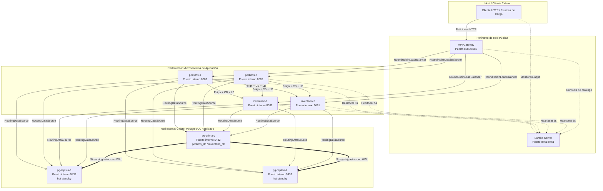
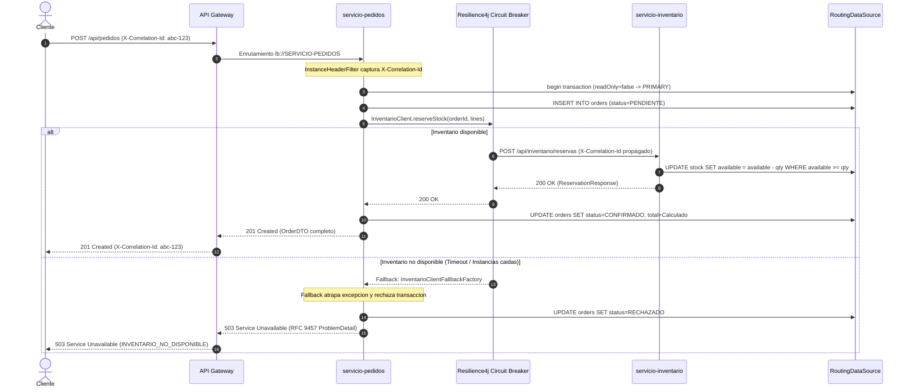
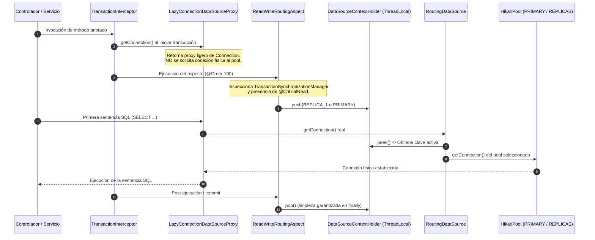

# Arquitectura del Sistema de Microservicios Distribuidos

Documento descriptivo de la arquitectura global, topología de red, flujos de comunicación y persistencia replicada del sistema.

---

## 1. Visión general del sistema

El sistema implementa una arquitectura orientada a microservicios desacoplados construida sobre **Java 21**, **Spring Boot 3.5.16** y **Spring Cloud 2025.0.3**, con persistencia relacional en **PostgreSQL 16** mediante replicación física por streaming de WAL asíncrono.

El entorno de ejecución está compuesto por 9 contenedores coordinados mediante Docker Compose:

1. **`eureka-server`**: Servidor de descubrimiento de servicios en modo standalone.
2. **`gateway`**: API Gateway reactivo basado en Spring Cloud Gateway (punto de entrada unificado para clientes externos).
3. **`servicio-pedidos` (2 instancias: `pedidos-1`, `pedidos-2`)**: Gestión de ciclo de vida de pedidos, agregados, máquina de estados y cálculo de totales.
4. **`servicio-inventario` (2 instancias: `inventario-1`, `inventario-2`)**: Gestión de catálogo de stock, reservas atómicas y liberaciones por compensación.
5. **Clúster PostgreSQL (3 nodos: `pg-primary`, `pg-replica-1`, `pg-replica-2`)**: Base de datos primaria de lectura/escritura y dos réplicas físicas de solo lectura en modo *hot standby*.

---

## 2. Diagrama de arquitectura y topología de componentes

---

## 3. Puertos de red y fronteras de exposición

Para garantizar aislamiento arquitectónico y seguridad perimetral, la configuración expone hacia el host exclusivamente los dos puertos de entrada necesarios:

| Servicio | Contenedor | Puerto Host | Puerto Interno | Visibilidad | Propósito |
| :-- | :-- | :-- | :-- | :-- | :-- |
| `gateway` | `gateway` | `8080` | `8080` | Pública (Host) | Punto de entrada unificado para todas las operaciones de API REST y enrutamiento perimetral. |
| `eureka-server` | `eureka-server` | `8761` | `8761` | Pública (Host) | Consola de descubrimiento y endpoint de registro de metadatos de instancias. |
| `servicio-pedidos` | `pedidos-1`, `pedidos-2` | *Ninguno* | `8082` | Red interna Docker | Acceso exclusivo vía API Gateway o mediante llamadas Feign internas. |
| `servicio-inventario` | `inventario-1`, `inventario-2` | *Ninguno* | `8081` | Red interna Docker | Acceso exclusivo vía API Gateway o mediante llamadas Feign internas. |
| PostgreSQL Primario | `pg-primary` | *Ninguno* | `5432` | Red interna Docker | Persistencia primaria de lectura y escritura; sin acceso directo desde el host. |
| PostgreSQL Réplica 1 | `pg-replica-1` | *Ninguno* | `5432` | Red interna Docker | Réplica física asíncrona de lectura; sin acceso directo desde el host. |
| PostgreSQL Réplica 2 | `pg-replica-2` | *Ninguno* | `5432` | Red interna Docker | Réplica física asíncrona de lectura; sin acceso directo desde el host. |

---

## 4. Distinción de los tres mecanismos de selección

Un aspecto fundamental de este sistema es la separación estricta entre los tres mecanismos independientes de resolución y balanceo:

| Mecanismo | Tecnología | Capa | Responsabilidad | Modo de fallo y mitigación |
| :-- | :-- | :-- | :-- | :-- |
| **1. Descubrimiento de Procesos** | **Eureka** (`DiscoveryClient`) | Catálogo distribuido de red | Registro dinámico de procesos en ejecución (`instance-id`), verificación de latidos (*heartbeats*) y expulsión por expiración de *lease*. | Si una instancia falla, Eureka la purga tras el vencimiento de su *lease* (15 s) más el ciclo del temporizador de barrido (3 s). |
| **2. Selección de Instancia HTTP** | **Spring Cloud LoadBalancer** | Transporte HTTP / Red cliente | Distribución equitativa (*round-robin*) de solicitudes HTTP entre las instancias saludables registradas en la caché local del cliente. | Si una instancia cae, el Circuit Breaker / reintento mitiga los errores durante la ventana transitoria de refresco de caché (3 s). |
| **3. Enrutamiento de Persistencia** | **RoutingDataSource** (`libs/persistence-routing`) | Transaccional JDBC en aplicación | Selección dinámica de la conexión física a base de datos (`PRIMARY` para escritura, `REPLICA_1` / `REPLICA_2` para lectura). | Si una réplica cae, la sonda activa la excluye en $\le 10\,\text{s}$; si caen ambas, entra en modo degradado transparente hacia `PRIMARY`. |

> **Nota arquitectónica**: `@Transactional(readOnly = true)` **no balancea tráfico HTTP ni selecciona instancias de microservicios**. Su función se limita a informar el modo de la transacción al aspecto AOP de persistencia para que el `RoutingDataSource` derive la consulta a una réplica de PostgreSQL.

---

## 5. Comunicación inter-servicio y resiliencia

Cuando un cliente crea un pedido (`POST /api/pedidos`), `servicio-pedidos` se comunica con `servicio-inventario` para reservar el stock requerido:

---

## 6. Flujo de enrutamiento transaccional de persistencia

Para resolver el problema de adquisición prematura de conexiones en Spring Data JPA e Hibernate, el sistema implementa la cadena de proxies diferidos:

### Características clave del diseño:
- **`LazyConnectionDataSourceProxy`**: Permite que el aspecto AOP capture el modo transaccional y establezca la clave en el `ThreadLocal` **antes** de que el pool entregue la conexión física.
- **`ThreadLocal<Deque<DataSourceKey>>`**: Estructura de pila que tolera transacciones anidadas (`REQUIRES_NEW`), restaurando la clave previa al completar la transacción interna.
- **`lenientFallback = false`**: Claves nulas resuelven de forma segura a `PRIMARY`; cualquier clave desconocida o inválida provoca un fallo ruidoso inmediato, evitando desvíos silenciosos.
