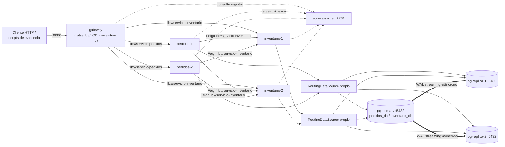

# Design: sistema-microservicios-distribuidos

Documento de diseño técnico derivado de `proposal.md`, de los 11 deltas bajo `specs/` y de `PLAN_IMPLEMENTACION.md` (§2, §4, §5, §6, §7).

> **Estado de A1**: el dominio Pedidos + Inventario fue confirmado por el usuario humano el 2026-11-18. Todo lo estructural (descubrimiento, gateway, balanceo, routing de persistencia, cluster, Compose) es agnóstico al dominio y no se reabre si A1 cambia.

## 1. Enfoque técnico

Cuatro decisiones se mantienen deliberadamente separadas, porque la rúbrica evalúa su separación y porque confundirlas produce diagnósticos falsos:

1. **Eureka descubre procesos.** No conoce bases de datos ni su salud.
2. **Spring Cloud LoadBalancer elige instancia HTTP.** No elige nodos de base de datos.
3. **`AbstractRoutingDataSource` elige nodo PostgreSQL.** No elige instancias de servicio.
4. **Resilience4j acota fallos de comunicación.** No compensa transacciones distribuidas: no existen.

El sistema se compone de un parent POM Maven multi-módulo, cuatro módulos ejecutables, un módulo técnico compartido de routing, y un entorno Compose de 9 contenedores (Eureka, Gateway, 2× pedidos, 2× inventario, primario PostgreSQL y 2 réplicas).

### Versiones `[verificar matriz oficial antes de generar el parent POM]`

| Componente | Versión | Nota |
| :-- | :-- | :-- |
| JDK | Temurin 21 (LTS) | `maven.compiler.release=21` |
| Spring Boot | 3.5.x | Parent POM; fija versiones de Micrometer y Hibernate |
| Spring Cloud | 2025.0.x | Release train alineado a Boot 3.5.x; **no** subir a Boot 4.x sin cambiar el train |
| PostgreSQL | 16 | Misma major en los tres nodos; `pg_basebackup` del mismo binario |
| Maven | 3.9.x | `mvn -T 1C verify` |
| JUnit 5 + Testcontainers | BOM de Boot | Imagen de test `postgres:16` |

El parent importa `spring-boot-dependencies` y `spring-cloud-dependencies` como BOM; ningún módulo declara versión de dependencia.

## 2. Diagrama de componentes



Línea punteada = plano de control (registro). Línea sólida = plano de datos. Las flechas hacia `pg-*` representan pools Hikari distintos por nodo.

## 3. Decisiones de arquitectura (ADR)

### ADR-01 — Mecanismo de selección de nodo de base de datos

| Opción | Compromiso | Decisión |
| :-- | :-- | :-- |
| `AbstractRoutingDataSource` + `LazyConnectionDataSourceProxy` + `ThreadLocal` + aspecto sobre `@Transactional` | Un único punto de decisión; transparente para repositorios y JPA; requiere control fino de orden de interceptores | **Elegida** |
| Múltiples `DataSource` inyectados con `@Qualifier` y elección en cada repositorio | La política se dispersa en N puntos; nada impide que un repositorio nuevo escriba en una réplica; JPA necesita un único `DataSource` por `EntityManagerFactory` | Descartada |
| AOP manual con `TransactionTemplate` programático por operación (sin `AbstractRoutingDataSource`) | Obliga a renunciar a `@Transactional` declarativo o a reimplementar el binding de recursos; duplica la gestión transaccional y pierde el soporte de Hibernate | Descartada |
| Dos `EntityManagerFactory` / dos `TransactionManager` (lectura y escritura) | Duplica metadatos y beans de repositorio; el routing pasa a ser "qué anotación escribió el programador", que es exactamente el error que la rúbrica penaliza | Descartada |
| Proxy externo (PgBouncer/HAProxy/pgpool) | Fuera de alcance declarado; no demuestra política propia y la rúbrica exige política implementada | Descartada |

**Motivo**: `AbstractRoutingDataSource` es el punto de extensión oficial de Spring para esta decisión; una sola implementación de `determineCurrentLookupKey()` concentra la política, y el par con el proxy perezoso resuelve el problema real de temporización (§5). **Límite aceptado**: la decisión se toma por transacción, no por sentencia; una transacción de escritura que además lee, lee del primario. Eso es coherente y se documenta.

### ADR-02 — Detección de réplica caída: sondeo activo vs solo excepción

| Opción | Compromiso | Decisión |
| :-- | :-- | :-- |
| Sondeo periódico activo con timeout corto; la excepción del driver solo demota de inmediato | Coste fijo de 2 conexiones de sondeo cada 5 s por servicio; detección medible y descomponible | **Elegida** |
| Exclusión solo por excepción del driver | El primer usuario paga la detección; `Connection.getConnection()` puede tardar todo el `connectionTimeout`; un socket medio abierto no produce excepción; no distingue "alcanzable" de "apta" (`hot_standby` acepta TCP aunque no replique); imposible medir detección como exige P06 | Descartada |
| Healthcheck del contenedor Docker como fuente de verdad | Mide el proceso, no el camino SQL de la aplicación; un contenedor `healthy` puede estar con el receiver detenido | Descartada |

**Motivo**: el spec `replicated-persistence-routing` exige que la exclusión dependa del sondeo y no del primer error de consulta, con detección ≤ 10 s y causa atribuible al timeout del sondeo.

### ADR-03 — Política de reparto de lecturas

| Opción | Compromiso | Decisión |
| :-- | :-- | :-- |
| Round-robin con cursor `AtomicInteger` sobre la lista de réplicas `UP` | Determinista, auditable, reconstruible desde la evidencia; con 2 réplicas el desbalance es como máximo 1 | **Elegida** |
| Aleatorio | No auditable: no se puede predecir ni explicar el reparto de una corrida; complica P05 y P08 | Descartada |
| Least-connections | Requiere instrumentar conexiones activas por nodo y estado compartido; con dos réplicas equivalentes el beneficio es nulo frente al coste de sincronización | Descartada |
| Sticky por clave de negocio (hash de cliente/SKU) | Mejora localidad de caché pero produce desbalance con pocas claves e impide demostrar reparto alternado | Descartada |

**Límite aceptado**: round-robin no conoce la carga real de cada réplica; si una réplica está lenta pero sana, recibe su turno igual. Se documenta como consecuencia, no se corrige.

### ADR-04 — Topología del cluster PostgreSQL

| Opción | Compromiso | Decisión |
| :-- | :-- | :-- |
| Un cluster (1 primario + 2 réplicas) con una base por servicio y un usuario por base | 3 contenedores de BD; el aislamiento se garantiza por credenciales y por permisos, no por convención | **Elegida** |
| Un cluster por servicio (3 + 3 contenedores de BD) | Aislamiento maximal, pero 15 contenedores totales: excede los recursos razonables del entorno de evaluación y el alcance de "9 contenedores" | Descartada |
| Una sola base con esquemas separados | El aislamiento deja de ser verificable: el mismo usuario podría cruzar esquemas; viola la regla de propiedad de datos | Descartada |
| Réplica lógica por tabla duplicada | Prohibido explícitamente por el enunciado | Descartada |

**Límite aceptado y documentado**: el cluster es un punto único de fallo compartido por ambos servicios. Un primario caído implica indisponibilidad de escritura para ambos; no hay promoción automática (fuera de alcance). La mitigación es de permisos (aislamiento lógico) más el error tipado ante primario caído, no de disponibilidad.

### ADR-05 — Imagen PostgreSQL y plan de contingencia

- **Decisión**: `postgres:16` oficial más entrypoint propio que ejecuta `pg_basebackup -R` en el arranque inicial de cada réplica.
- **Descartada (por defecto)**: `bitnami/postgresql` con `POSTGRESQL_REPLICATION_MODE`. La distribución de imágenes Bitnami cambió: los tags gratuitos se movieron a `bitnamilegacy` y la línea gratuita ya no garantiza inmutabilidad de tags. Un tag que se mueve o desaparece rompe la reproducibilidad exigida y puede fallar el día de la defensa.
- **Contingencia**: si el entrypoint propio retrasa W7, se admite `bitnami/postgresql` **pineada por digest** (`@sha256:...`), verificada en la prueba de humo de W1, y se registra el digest en `README.md` y en `.env.example`. Nunca por tag flotante.
- **Por qué el entrypoint propio es barato**: son dos archivos (`infra/postgres/primary-entrypoint.sh`, `infra/postgres/replica-entrypoint.sh`) y eliminan una dependencia externa con historial de inmutabilidad roto.

### ADR-06 — Flyway apunta al `DataSource` primario

- **Decisión**: bean `Flyway` explícito construido con `primaryDataSource`, con auto-configuración de Flyway deshabilitada. **No** se apunta al `RoutingDataSource` ni a una URL JDBC suelta.
- **Alternativa descartada**: dejar que la auto-configuración tome el `DataSource` primario del contexto (el routing, que resuelve a primario cuando no hay clave). Funciona **por accidente**: depende de que `defaultTargetDataSource` siga siendo el primario y de que nadie ejecute la migración dentro de una transacción con clave de lectura. Es un acoplamiento silencioso que se rompe sin aviso.
- **Alternativa descartada**: migrar contra cada nodo. Las réplicas están en `hot_standby` y rechazan DDL; además el esquema llega replicado.
- **Motivo**: el `RoutingDataSource` es un router, no una fuente de verdad de escritura; y una migración contra una réplica falla por diseño del motor. Está además fijado como regla en `openspec/config.yaml`.

### ADR-07 — `@CriticalRead` frente a alternativas de consistencia

| Opción | Compromiso | Decisión |
| :-- | :-- | :-- |
| Anotación explícita que fuerza primario, medible y auditable | Carga el primario; requiere disciplina de uso | **Elegida** |
| Todas las lecturas al primario | Anula el objetivo de distribución de lecturas | Descartada |
| Barrera por `replay_lag`: esperar lag < umbral y leer de réplica | Latencia variable e impredecible; no garantiza nada si el lag no baja; exigiría exponer el LSN del último commit al microservicio, acoplando capas; y `replay_lag` es una métrica del primario, no una garantía por transacción | Descartada |
| Devolver la representación en la respuesta del POST y no volver a leer | Elimina la necesidad en el caso general; **regla preferente**, pero el enunciado exige además una lectura crítica inmediata posterior a la escritura (P07) | Complementaria, no sustitutiva |
| Replicación síncrona | Ver ADR-08 | Descartada |

### ADR-08 — Replicación asíncrona

- **Decisión**: streaming asíncrono (`synchronous_standby_names` vacío, `synchronous_commit=on` para durabilidad local).
- **Alternativa descartada**: replicación síncrona. (i) Una réplica caída bloquearía o degradaría las escrituras; (ii) elimina el lag y con él la justificación de la política de consistencia que P07 exige argumentar con un `replay_lag` real; (iii) no es el comportamiento por defecto del streaming en Docker, así que se estaría construyendo un escenario artificial.
- **Coste declarado**: lag no acotado. Se asume y se compensa con `@CriticalRead`, con `wal_keep_size` y con un procedimiento de re-clone documentado.

### ADR-09 — Módulo técnico compartido de routing

- **Decisión**: `libs/persistence-routing` contiene exclusivamente infraestructura técnica (claves de nodo, contexto, selector, registry, aspecto, anotación, métricas). Cero `@Entity`, cero repositorios, cero DTO de dominio.
- **Alternativa descartada**: duplicar las clases en ambos servicios. Dos copias divergen en la primera corrección y la evidencia de P05/P06 dejaría de ser comparable entre servicios.
- **Alternativa descartada**: poner el código en el parent POM. El parent debe tener `packaging=pom` y ninguna clase.
- **Riesgo controlado**: es acoplamiento **técnico**, no de dominio. La frontera se verifica con una revisión de dependencias del módulo y una regla de empaquetado: si aparece un tipo de dominio, la revisión falla.

## 4. Cadena de routing de persistencia (núcleo, 20 puntos)

### 4.1 Piezas y contratos

| Pieza | Responsabilidad | Contrato (firma, no implementación) |
| :-- | :-- | :-- |
| `DataSourceKey` (enum) | Vocabulario cerrado de nodos | `PRIMARY`, `REPLICA_1`, `REPLICA_2` |
| `primaryDataSource`, `replica1DataSource`, `replica2DataSource` | Un `HikariDataSource` por nodo, pools independientes | `@Bean` nombrados |
| `RoutingDataSource extends AbstractRoutingDataSource` | Mapa clave→pool, `defaultTargetDataSource=primary`, `lenientFallback=false` | `protected Object determineCurrentLookupKey()` |
| `DataSourceContextHolder` | `ThreadLocal<Deque<DataSourceKey>>` (pila, no valor único) | `push`, `pop`, `clear`, `peek` |
| `LazyConnectionDataSourceProxy` | Difiere la conexión física hasta la primera sentencia | envuelve al `RoutingDataSource`; es el bean `dataSource` que consume JPA |
| `ReadWriteRoutingAspect` | Traduce `readOnly` + `@CriticalRead` a una clave | `@Around("@annotation(Transactional) || @within(Transactional)")` |
| `ReplicaSelector` | Round-robin sobre la foto de réplicas `UP` | `DataSourceKey select()` |
| `ReplicaHealthRegistry` | Sondeo, estado `UP/DOWN`, métrica y motivo | `isAvailable(DataSourceKey)` |
| `RoutingDecisionRecorder` | Registra la decisión del request para headers y logs | `record`, `decisions()` |

**Por qué pila y no valor simple**: con transacciones anidadas (`REQUIRED` reutiliza la de afuera; `REQUIRES_NEW` abre otra), un `@CriticalRead` dentro de un método de lectura ordinaria debe restaurar la clave previa al salir, no limpiar el contexto. `pop()` en `finally` garantiza simetría.

**Por qué `lenientFallback=false`**: una clave nula resuelve al primario (comportamiento de `AbstractRoutingDataSource` y elección segura: sin contexto nunca se lee de una réplica potencialmente retrasada), pero una clave **no nula y desconocida** debe fallar de forma ruidosa en vez de desviarse en silencio al primario. Un fallback silencioso convertiría un error de configuración en "todo funciona, pero P05 da primario".

### 4.2 Precedencia de decisión

| Situación | Clave resultante | Justificación |
| :-- | :-- | :-- |
| `@Transactional` con `readOnly=false` | `PRIMARY` | Toda escritura, sin excepción |
| `@Transactional` con `readOnly=true` | réplica `UP` (round-robin) | Reparto de lecturas |
| `@Transactional(readOnly=true)` + `@CriticalRead` | `PRIMARY` | Read-your-writes gana sobre el reparto |
| `@CriticalRead` sin transacción activa | `PRIMARY` | Autocommit sobre primario; nunca se lee dato propio de una réplica |
| Sin transacción y sin anotación | `PRIMARY` (clave nula → default) | El default debe ser el nodo autoritativo |
| Todas las réplicas `DOWN` | `PRIMARY` + `WARN` + métrica `db_routing_degraded_total` | Modo degradado explícito (P06b) |

**Aclaración que el informe debe contener literalmente**: `@Transactional(readOnly = true)` **no balancea nada por sí solo**. Solo declara el modo de la operación; la selección del nodo la hace el selector de réplicas y la aplica el aspecto. Si se quita el aspecto, todas las transacciones —de lectura y de escritura— van al primario y el sistema sigue funcionando: eso demuestra que la anotación no era el mecanismo. Es el punto que el enunciado advierte y el que más se pierde por confusión conceptual.

### 4.3 Por qué el proxy perezoso es obligatorio

El orden real de los hechos, sin proxy perezoso:

1. `TransactionInterceptor` abre la transacción: `AbstractPlatformTransactionManager.doBegin()` pide la conexión al `DataSource` (`DataSourceUtils.getConnection` → `routingDataSource.getConnection()`).
2. En ese instante `AbstractRoutingDataSource.getConnection()` invoca `determineCurrentLookupKey()`. El `ThreadLocal` está vacío → clave nula → `defaultTargetDataSource` → **primario**.
3. Solo después `AbstractPlatformTransactionManager` registra el estado de la transacción en `TransactionSynchronizationManager` (`prepareSynchronization` ocurre **después** de `doBegin`), y solo después puede correr cualquier aspecto interno que lea `isCurrentTransactionReadOnly()`.

Es decir: la conexión se adquiere **antes** de que exista una respuesta a "¿esta transacción es de solo lectura en nuestra política?". El resultado no es un error visible: es que el 100 % de las lecturas aterriza en el primario y P05 falla por una razón que no aparece en ningún log. Ese es el modo de fallo caro.

Con `LazyConnectionDataSourceProxy`:

1. `getConnection()` devuelve un `Connection` proxy. Las propiedades de conexión (`autoCommit`, `readOnly`, `transactionIsolation`, `catalog`, `holdability`) se almacenan en el handler y **no** disparan adquisición.
2. El aspecto de routing corre con la transacción ya activa → `readOnly` y `@CriticalRead` son visibles → escribe la clave en el `ThreadLocal`.
3. La primera sentencia fuerza `prepareConnection()` → `routingDataSource.getConnection()` → `determineCurrentLookupKey()` lee el `ThreadLocal` → pool correcto.
4. Al cerrar, el proxy cierra la conexión física si llegó a abrirse; si no se abrió (método que no toca la base), no hubo coste.

Consecuencia operativa: la decisión se toma **por transacción y una sola vez**, en el momento en que se conoce el modo y antes de emitir la sentencia, que es exactamente lo que exige el spec `replicated-persistence-routing`.

### 4.4 Orden de interceptores: la mitad que suele olvidarse

El proxy perezoso resuelve la adquisición temprana; **no** resuelve el orden. Si el aspecto de routing corre *fuera* del `TransactionInterceptor`, no hay transacción activa y `isCurrentTransactionReadOnly()` devuelve `false` para todo. `@Transactional` se habilita con `@EnableTransactionManagement(order = ...)` y el aspecto declara una precedencia **interna** a la del interceptor transaccional (valor de orden mayor). Regla de diseño verificable: un test de integración que lea una réplica y otro que escriba en el primario deben pasar; si el orden se invierte, el de lectura falla. Ese test es el guardián del cableado, no la revisión manual.

Segundo detalle obligatorio: `spring.jpa.open-in-view=false`. Con OSIV, la `EntityManager` se abre fuera de la transacción y la primera sentencia puede emitirse en un momento donde la decisión ya no corresponde al modo declarado. Es una regla fijada en `openspec/config.yaml` y no una preferencia.

### 4.5 Cableado a nivel de beans (patrón no obvio)

```text
replica1DataSource  (Hikari, nodo replica-1)
replica2DataSource  (Hikari, nodo replica-2)
primaryDataSource   (Hikari, nodo primary)
        │
        ├── routingDataSource = RoutingDataSource(targetDataSources={PRIMARY,REPLICA_1,REPLICA_2},
        │                                         defaultTargetDataSource=primary, lenientFallback=false)
        │        │
        │        └── dataSource = LazyConnectionDataSourceProxy(routingDataSource)   ← consumido por JPA
        │
        └── flyway = Flyway(primaryDataSource)          ← nunca el routing, nunca el proxy perezoso
hibernate.ddl-auto=validate · open-in-view=false · initializationFailTimeout=-1 por pool
```

`initializationFailTimeout=-1` es deliberado: con el valor por defecto, un servicio **no arranca** si una réplica está caída, lo que contradice el requisito de continuidad. El pool se crea en modo diferido y falla al pedir conexión, no al crear el bean.

### 4.6 Secuencia: lectura ordinaria (`GET /api/pedidos`)

```text
[t0]  Cliente ──GET /api/pedidos──────────────────────────────▶ Gateway :8080
[t1]  Gateway ── CorrelationIdFilter (reusa o genera) ─ CB ─ lb://servicio-pedidos
[t2]  LoadBalancer ── instancia pedidos-2 (cache de Eureka, TTL ≤ 3 s) ── HTTP
[t3]  pedidos-2 ── TransactionInterceptor: begin(readOnly=true)
[t4]  pedidos-2 ── LazyConnectionDataSourceProxy.getConnection()
                   └─ devuelve un proxy de Connection; NO se abre conexión física
[t5]  Aspecto ──── selector.select() = REPLICA_1 ── ThreadLocal.push(REPLICA_1)
[t6]  JdbcTemplate ── primera sentencia
                   └─ LazyProxy.prepareConnection() ──▶ RoutingDataSource.getConnection()
                      └─ determineCurrentLookupKey() = REPLICA_1 ──▶ Hikari[replica-1]
[t7]  pg-replica-1 ── SELECT ... ──▶ filas
[t8]  Aspecto ──── finally: ThreadLocal.pop()   (la clave no sobrevive al request)
[t9]  pedidos-2 ── 200 + X-Data-Source: REPLICA_1 + X-Service-Instance: pedidos-2
[t10] Gateway ──── eco de X-Correlation-Id ──▶ Cliente
```

Nota de evidencia: `X-Data-Source` lo emite la aplicación a partir de la **decisión**; por eso solo vale contrastado con `pg_stat_activity` y `log_statement=all` del nodo (§14). El header es una hipótesis, la base es la prueba.

## 5. Selector de réplicas

**Algoritmo**: sobre una foto inmutable de las réplicas en estado `UP` (orden `REPLICA_1`, `REPLICA_2`), el cursor `AtomicInteger` avanza con `Math.floorMod(cursor.getAndIncrement(), size)`. La foto se toma por lectura atómica de una referencia inmutable publicada por el registry, de modo que un cambio de salud nunca produce un índice fuera de rango ni una lista a medio mutar.

- **Lista vacía**: devuelve `PRIMARY` y marca la transición a modo degradado. Se emite `WARN` **una vez por entrada** al modo (no una por request: el log debe ser señal, no ruido) y se incrementa `db_routing_degraded_total`. El cliente nunca recibe error por esto (P06b).
- **Réplica que cae entre el chequeo y el uso**: no se puede eliminar, se acota. Tres mecanismos: (1) el sondeo de 5 s reduce la probabilidad a una ventana pequeña; (2) un pool cuyo `getConnection()` falla demota el nodo de inmediato (`registry.markDown(key, "connection-refused")`), así el **siguiente** request ya no lo elige; (3) no se reintenta dentro de la transacción, porque reintentar en medio de una transacción abierta arriesga efectos parciales. El request afectado termina con error tipado `503 DB_NODE_UNAVAILABLE`, que se cuenta como error transitorio en P06 y se explica por la ventana, no se oculta.
- **Qué pasa con el pool de la réplica caída**: el `HikariDataSource` no se cierra ni se desvincula del mapa de routing (el mapa es inmutable tras el arranque, y reconstruirlo filtraría pools). Las conexiones en vuelo fallan por RST o agotan `connectionTimeout=2000 ms`; las ociosas se descartan por validación al préstamo y por `maxLifetime`. Al volver el nodo, el mismo pool se reutiliza: no hay reconexión de beans ni reinicio del servicio. Coste declarado: mientras el nodo está caído, `keepaliveTime` y `minimumIdle` generan intentos fallidos periódicos; se aceptan y se documentan como ruido de pool, no como error de negocio.
- **Determinismo para la evidencia**: el cursor es por instancia de servicio, no global; por eso P05 se evalúa por instancia y el informe declara el punto de partida del cursor. Sin eso, "no alterna" y "alternó dos veces desde otro proceso" son indistinguibles.

## 6. Health registry

| Parámetro | Valor | Motivo |
| :-- | :-- | :-- |
| Intervalo | `fixedDelay = 5000 ms` | Detección ≤ 10 s con margen; suficiente para no saturar |
| Timeout de sondeo | `1000 ms` (conexión y validación) | Un nodo colgado no bloquea el hilo de sondeo |
| Consulta de validación | `SELECT 1` | Verifica el camino SQL real, no el puerto |
| Condición de reincorporación | `SELECT 1` OK **y** `pg_stat_wal_receiver.status = 'streaming'` **y** 2 sondeos consecutivos verdes | El spec P08 exige streaming activo, no alcanzabilidad |
| Aislamiento de sondeo | Grupo de scheduling propio, `pool.size=4`, una tarea por nodo | Un nodo colgado no retrasa el sondeo del otro |

**Criterio de reincorporación en dos pasos**: 1 sondeo verde lleva el nodo a `PROBING` (sigue excluido); 2 consecutivos verdes lo llevan a `UP` (≈10 s). Se evita el flap de un nodo que responde una vez y vuelve a caer, y se mantiene P08 dentro de los 60 s.

**Por qué no puede depender de la excepción del driver**: (a) el driver solo se entera cuando un request ya decidió usar ese nodo, así que el coste de la detección lo paga un usuario; (b) `connectionTimeout=2000 ms` significa que un nodo caído añade 2 s a la latencia del request que lo eligió, y una ventana de detección de 5 s puede contener varios de esos; (c) el error del driver es ambiguo: pool agotado, nodo caído, credencial inválida y timeout de red se parecen; el sondeo distingue y permite atribuir la causa, que es lo que P06 exige por escrito; (d) una réplica puede aceptar TCP y devolver `SELECT 1` con el receiver detenido: solo la condición de streaming la excluye correctamente.

**Salida observable**: métrica `replica_health{node}` (1 = UP, 0 = DOWN) y log `level=INFO/WARN node=REPLICA_1 state=DOWN cause=probe-timeout elapsedMs=1000 probe=SELECT 1`. Ese log es la fuente primaria de P06.

### 6.1 Secuencia: fallo y exclusión de una réplica (P06 → P06b → P08)

```text
t   Registry(5s)        Selector        Hikari[r1]     pg-replica-1        Evidencia
0   probe(r1) OK        foto={r1,r2}    válido         SELECT 1 OK
5   probe(r1) ──────────────────────────────────────▶  (contenedor detenido)
    timeout 1000ms → FAIL → markDown(r1, probe-timeout)
    replica_health{REPLICA_1}=0 · WARN cause=probe-timeout
    foto={r2}  ← publicada atómicamente
6   lecturas siguientes → r2 (100 %)                    log de salud + pg_stat_activity de r2
    detección medida = 5 s intervalo + 1 s timeout = 6 s  (techo declarado 10 s)
…
    (P06b) probe(r2) FAIL → foto={} → PRIMARY + WARN + db_routing_degraded_total++
    (P08) r1 arranca → probe OK → PROBING (excluida) → 2.º probe OK
          + pg_stat_wal_receiver.status='streaming' → UP → vuelve a recibir lecturas
```

El punto que la evidencia debe mostrar: entre el primer `FAIL` y la primera lectura en `r2` no hay ningún error de negocio atribuible a "excepción de consulta"; la causa es `probe-timeout`.

## 7. `@CriticalRead`

- **Propagación**: anotación en método (no en clase, para evitar contaminar controladores enteros). El aspecto, ya dentro de la transacción, escribe `PRIMARY` en el `ThreadLocal` y registra `critical_read_total`. En `finally` hace `pop()`, restaurando la clave anterior del método llamador.
- **Combinación con `@Transactional(readOnly=true)`**: gana `@CriticalRead` para el nodo, y el hint `readOnly` se conserva para la conexión. Es intencional: el primario atiende la lectura y el modo de solo lectura del motor impide que una lectura crítica escriba por accidente. No hay conflicto conceptual: `readOnly` describe la **naturaleza** de la operación, la anotación describe la **necesidad de consistencia**.
- **Sin transacción**: se enruta igual a `PRIMARY` (cada sentencia autocommit contra el primario). La validación de arranque emite `WARN` indicando el método sin transacción, porque el patrón esperado es uno de estos dos: `@Transactional(readOnly=true) + @CriticalRead`, o dentro de una transacción de escritura ya en curso.
- **Qué no hace**: no abre transacción, no espera al lag, no reintenta, no toca el reparto de las lecturas ordinarias.
- **Cómo se evita que sea parche universal** (cinco barreras, todas verificables):
  1. **Regla de preferencia**: la respuesta de la escritura devuelve la representación completa; si el cliente tiene el dato, no hace falta lectura crítica. Se aplica al `201` de `POST /api/pedidos`.
  2. **Lista blanca ejecutable**: un test enumera los métodos anotados con `@CriticalRead` y falla si aparece uno fuera de la lista acordada (`GET /api/pedidos/{id}` y la lectura de precio/vigencia necesaria antes de reservar). Añadir una excepción exige cambiar el test: fricción deliberada.
  3. **Proporción medida**: `critical_read_total / db_routing_total` se reporta en la evidencia; por encima del 5 % se documenta como abuso y se revisa. Un primario que atiende todas las lecturas hace que P05 sea una ficción.
  4. **Prohibición explícita**: nada de `@CriticalRead` en listados, búsquedas por filtro ni endpoints que alimentan tablas del cliente. Rúbrica de revisión en `docs/decisiones.md`.
  5. **Coste escrito**: la anotación traslada carga al nodo no escalable y elimina el beneficio de las réplicas para esa ruta. La decisión declara ese coste (ADR-07), de modo que usarla de más es una decisión visible, no un accidente.

### 7.1 Secuencia: lectura crítica inmediata a la escritura (P07)

```text
[s1] Cliente ──POST /api/pedidos──▶ pedidos-2
[s2] pedidos-2 ── Tx1 (PRIMARY): INSERT pedido PENDIENTE + líneas ── commit
[s3] pedidos-2 ── Feign lb://servicio-inventario ──▶ inventario ── reserva ── commit
[s4] pedidos-2 ── Tx2 (PRIMARY): total desde precios de inventario; estado = CONFIRMADO
[s5] pedidos-2 ──201 {pedido completo: id, estado, total, líneas}──▶ Cliente
                  └─ barrera 1: el cliente ya tiene el dato; la lectura crítica no es obligatoria
[s6] Cliente ──GET /api/pedidos/{id} (crítica)──▶ pedidos-2
[s7] pedidos-2 ── Tx: begin(readOnly=true)
[s8] Aspecto ──── @CriticalRead: push(PRIMARY), gana sobre readOnly
[s9] pedidos-2 ── primera sentencia ──▶ PRIMARY  (el hint readOnly viaja a la conexión)
[s10] Evidencia ── pg_stat_replication.replay_lag del instante de [s9]  ──▶ informe P07
[s11] pedidos-2 ──200 {dato recién escrito} + X-Data-Source: PRIMARY──▶ Cliente
[s12] Aspecto ──── finally: pop() ── contexto restaurado
```

Precedencia aplicada: la anotación gana sobre `readOnly=true`; el hint de solo lectura se conserva, de modo que la lectura crítica **no puede** escribir aunque el código lo intentara. El `replay_lag` se registra en el mismo instante de la lectura porque es lo que justifica la política; sin ese dato, la conclusión sería una afirmación sin sustento.

## 8. Topología PostgreSQL

```text
pg-primary (postgres:16)                        pg-replica-1 / pg-replica-2 (postgres:16)
  wal_level=replica                               standby.signal presente
  max_wal_senders=10                              hot_standby=on
  wal_keep_size=512MB                             primary_conninfo → pg-primary
  max_connections=100                             recovery target = latest
  synchronous_standby_names=''  ← asíncrono      log_statement=all (perfil evidencia)
  log_statement=all (perfil evidencia)
  databases: pedidos_db (owner pedidos_app), inventario_db (owner inventario_app)
  role: replicator (REPLICATION), sin superusuario, sin acceso a las bases de negocio
```

- **Imagen y arranque**: `postgres:16`; el primario usa un wrapper que añade `host replication replicator 0.0.0.0/0 scram-sha-256` a `pg_hba.conf` (la entrada `all` **no** cubre la pseudo-base `replication`) y luego delega en el entrypoint oficial. La réplica, con `PGDATA` vacío, ejecuta `pg_basebackup -h pg-primary -U replicator -D "$PGDATA" -Fp -Xs -R -P` y arranca; con `PGDATA` poblado, solo arranca. `-R` deja `standby.signal` y `primary_conninfo`.
- **Secreto en `primary_conninfo`**: `-R` escribe credenciales en `postgresql.auto.conf`. Se usa `passfile` dentro del contenedor generado en tiempo de ejecución, de modo que la contraseña no queda en `auto.conf` ni en la imagen; nada de esto se versiona.
- **Réplica de base por servicio**: los usuarios de aplicación solo tienen privilegios sobre su base, así el aislamiento no depende de la disciplina del código. `replicator` no puede leer datos de negocio: solo replicación física.
- **Sin slots de replicación** (`max_replication_slots=0`): se prefiere `wal_keep_size` a un slot, porque un slot sin consumidor retiene WAL y puede llenar el disco del primario. Coste declarado: una parada de réplica más larga que la retención de WAL exige re-clone (`pg_basebackup` de nuevo); el procedimiento va en el README y P08 usa una parada corta.
- **Arranque ordenado** (Compose): `pg-primary` con `pg_isready -U replicator` → réplicas con `depends_on: service_healthy` y healthcheck `pg_isready` → servicios de negocio tras `pg-primary` y Eureka sanos. `depends_on` con condición de salud es lo que evita el fallo intermitente de arranque.
- **Puertos**: `5432` interno en los tres nodos; ninguno publicado. El primario admite mapeo opcional a `55432` solo para diagnóstico y se documenta en el README (no es parte del camino de evidencia por defecto).

## 9. Flyway

- **Por qué al primario**: las réplicas son `hot_standby` y rechazan DDL por diseño del motor; y un router no es una fuente de verdad de escritura. Apuntar Flyway al `RoutingDataSource` funciona solo mientras el default sea el primario, es decir por accidente, y falla en cuanto alguien ejecuta la migración dentro de una transacción con clave de lectura.
- **Cómo se configura sin romper el routing**: se desactiva la auto-configuración de Flyway (`spring.flyway.enabled=false`), se declara un bean `Flyway` con `primaryDataSource` y `locations=classpath:db/migration/{servicio}`, y se garantiza el orden con un `EntityManagerFactoryDependsOnPostProcessor` que declare dependencia del bean `flyway`. Así `ddl-auto=validate` corre después de migrar, y la validación de esquema ocurre contra el primario (vía routing con clave nula), nunca contra una réplica.
- **Semántica**: migraciones inmutables, versionadas y aditivas; `baseline-on-migrate=false`; `connect-retries=10` para tolerar el arranque del primario en Compose. Cada servicio tiene su carpeta de migraciones y su tabla `flyway_schema_history` en su propia base: no se comparte historia entre servicios.

## 10. Eureka en Docker

| Ajuste | Valor | Motivo |
| :-- | :-- | :-- |
| `instance-id` | `${spring.application.name}:${INSTANCE_ID:${HOSTNAME:local}}` | Único por contenedor; `INSTANCE_ID` se fija en Compose (`pedidos-1`, …) y es la misma cadena del header y del MDC |
| `eureka.client.register-with-eureka` / `fetch-registry` (servidor) | `false` | Un servidor standalone no se registra ni se consulta a sí mismo |
| `prefer-ip-address` | `true` | Resolución estable dentro de la red `backend`; evita nombres de host que el gateway no resuelve |
| `lease-renewal-interval-in-seconds` | `5` | Hace observable la expulsión |
| `lease-expiration-duration-in-seconds` | `15` | Spec P03; sin esto la expulsión por defecto (~90 s) hace que el escenario parezca roto |
| `registry-fetch-interval-seconds` (clientes) | `5` | Propaga altas y bajas |
| `eureka.server.enable-self-preservation` | `false` | **Crítico**: con 2 instancias y lease de 15 s, la autopreservación bloquearía la expulsión y P03 nunca vería la baja |
| `eureka.server.eviction-interval-timer-in-ms` | `3000` | El barrido por defecto es de 60 s y anularía el lease de 15 s |
| `eureka.server.response-cache-update-interval-ms` | `1000` | El cache de respuesta por defecto es de 30 s; dominaría toda la ventana |
| `eureka.server.use-read-only-response-cache` | `false` | Elimina un segundo nivel de cache con su propio retraso |
| LB cache TTL | `spring.cloud.loadbalancer.cache.ttl=3s` | El valor por defecto (35 s) convertiría la ventana transitoria en el comportamiento dominante |
| LB retry | `max-retries-on-next-service-instance=1`, solo operaciones idempotentes | Enmascara el "connection refused" típico sin ocultar fallos reales |

**Ventana de errores transitorios esperada (P03), declarada de antemano**: instancia detenida en `t0`; última renovación ≤ 5 s antes, expiración entre `t0+10 s` y `t0+15 s`; barrido ≤ 3 s; fetch del cliente ≤ 5 s; TTL del cache del LB ≤ 3 s. Total: **entre ~15 s y ~26 s** hasta que deja de recibir tráfico. Durante esa ventana el gateway puede seguir ofreciendo la instancia muerta: falla por conexión rechazada (rápido), se reintenta una vez en otra instancia y solo los intentos que agotan el presupuesto se cuentan como error. Esa es la explicación que P03 debe contener con números, no con adjetivos.

**Reincorporación**: el proceso arranca y se registra en ≤ 5 s (`initial-instance-info-replication-interval-seconds=5`), el gateway lo ve en ≤ 5 s y lo usa en ≤ 3 s de TTL → **≤ 13 s típico, 30 s como techo declarado**. Cumple el criterio de P03 sin necesidad de reiniciar gateway ni registro.

## 11. Gateway

- **Rutas explícitas** (no discovery locator, para que la ruta declarada sea auditable):
  `Path=/api/pedidos/**` → `lb://servicio-pedidos`; `Path=/api/inventario/**` → `lb://servicio-inventario`.
- **Filtros**, en este orden:
  1. `CorrelationIdFilter` (`GlobalFilter`, orden alto): lee `X-Correlation-Id` entrante, genera uno si falta, muta el request con `exchange.getRequest().mutate().header(...)` —mutar el request es obligatorio: añadir el header a la respuesta no lo propaga aguas abajo— y lo escribe también en la respuesta.
  2. `CircuitBreaker` por ruta (Resilience4j reactor): ventana de 10 llamadas, umbral 50 %, apertura 10 s, 3 llamadas de prueba en semiabierto; fallback que responde `503 application/problem+json` con `code`, `correlationId` y ruta.
  3. `Retry` solo en `GET` (método idempotente), máximo 1 intento.
  4. Timeouts: `connect-timeout=2s`, `response-timeout=8s`. El presupuesto interno de una creación de pedido es ≈ 5 s (dos transacciones locales + Feign con reintento acotado); el timeout del gateway debe ser **mayor** que el interno, o el gateway corta antes de que el servicio pueda devolver su error tipado.
- **Pools**: Reactor Netty con `pool.max-connections=200`, `pool.max-idle-time=20s`, `pool.acquire-timeout=5s`, `pool.max-pending-acquire=100`. Con dos rutas y carga de evidencia (100 requests secuenciales), 200 conexiones es holgura suficiente y el `acquire-timeout` impide que un pool agotado convierta un pico en un cuelgue.
- **Puerto**: `8080` publicado; único punto de entrada de negocio.

## 12. Comunicación Feign + Resilience4j

- **Cliente**: `@FeignClient(name = "servicio-inventario", path = "/api/inventario", fallbackFactory = ...)`; resolución por nombre lógico con `spring-cloud-starter-loadbalancer`. Prohibido host/puerto en configuración (regla verificable con un `grep` en el pipeline de revisión).
- **Presupuesto de tiempo**: conexión `500 ms`, lectura `1500 ms`. `Retryer` explícito de **1 reintento** y solo sobre errores de conexión; es seguro porque la reserva es idempotente por `pedidoId`.
- **Circuit breaker** (`inventario`): `slidingWindowCount=10`, `minimumNumberOfCalls=5`, `failureRateThreshold=50 %`, `slowCallDurationThreshold=1500 ms`, `slowCallRateThreshold=50 %`, `waitDurationInOpenState=10 s`, `permittedNumberOfCallsInHalfOpenState=3`. En abierto, la llamada falla **sin tocar la red** y el estado se publica en log y en `resilience4j_circuitbreaker_state`.
- **Sin `TimeLimiter`**: un `TimeLimiter` de Resilience4j ejecuta en otro hilo, y el `ThreadLocal` de routing no cruza hilos; además rompería el contexto transaccional. El límite temporal lo da el `readTimeout` de Feign (bloqueante, mismo hilo). Decisión explícita, no omisión.
- **Fallback tipado**: la `fallbackFactory` produce una excepción de dependencia con código estable; un `@RestControllerAdvice` la traduce a `503` con `type`, `title`, `detail`, `code=INVENTARIO_NO_DISPONIBLE` y `correlationId`. Nunca `500` genérico.
- **Consistencia sin transacciones distribuidas** (secuencia):

```text
pedidos                                    inventario
   │ Tx1 (PRIMARY): INSERT pedido PENDIENTE + líneas (sku, cantidad)
   │                              ── commit ──
   │── POST /api/inventario/reservas {pedidoId, líneas} (Feign lb://) ──▶│ Tx (PRIMARY): reserva atómica
   │                                                                     │ idempotente por pedidoId
   │◀── 200 {líneas reservadas con precio vigente, total} ───────────────│ ── commit ──
   │ Tx2 (PRIMARY): total = suma de precios de inventario; estado = CONFIRMADO
   │
   │◀── 409 {skusFaltantes} → Tx2: estado = RECHAZADO (sin stock tocado)
   │◀── timeout / circuito abierto → best-effort: POST /reservas/{pedidoId}/liberacion
   │                                 (idempotente; fallo = WARN + métrica, no revierte nada)
   │                              → estado queda PENDIENTE, respuesta 503 tipada
```

**Por qué así**: la reserva es atómica **dentro** de inventario (una transacción local, todas las líneas o ninguna), de modo que no existe "reserva parcial" en el lado del dueño del stock. El riesgo real es el caso "reserva confirmada pero respuesta perdida": se cubre con idempotencia por `pedidoId` (un reintento no duplica consumo) y con liberación compensatoria best-effort. El estado `PENDIENTE` es un estado honesto: el pedido existe, el stock **no** está garantizado y el cliente recibe un error tipado. No se inventa un `CONFIRMADO` sin stock comprometido ni una saga.

## 13. Observabilidad para la evidencia

| Capa | Artefacto | Uso en evidencia |
| :-- | :-- | :-- |
| HTTP | `X-Correlation-Id` (aceptado o generado), `X-Service-Instance`, `X-Data-Source` | P01–P08; `X-Data-Source` solo como hipótesis a contrastar |
| Log de aplicación | Línea estructurada `key=value`: `correlationId`, `service`, `instanceId`, `routingKey`, `txReadOnly`, `criticalRead`, `sql`, `durationMs`, `outcome` | P04 (mismo `correlationId` en ambos servicios), P05, P06b |
| Log de routing | `routing decision node=REPLICA_1 reason=read-only cursor=7` | Reparto reconstruible y punto de partida del cursor |
| Log de salud | `probe node=REPLICA_1 state=DOWN cause=probe-timeout elapsedMs=1000` | Fuente primaria de P06/P08 |
| Micrometer | `db_routing_total{node,outcome}`, `db_routing_degraded_total`, `replica_health{node}` (gauge), `replica_probe_duration_seconds`, `critical_read_total`, `lb_requests_total{service,instance}`, `resilience4j_circuitbreaker_state` | P05, P06b, P07, y defensa del uso de `@CriticalRead` |
| Actuator | `/actuator/health`, `/actuator/metrics`, `/actuator/prometheus` (registry Prometheus en servicios y gateway) | Formato de texto fácil de `grep` en scripts, sin necesidad de un scraper |
| PostgreSQL | `pg_stat_activity` (con `application_name` = instancia), `log_statement=all`, `pg_stat_database` (deltas de `tup_returned`, `xact_commit`), `pg_stat_replication` (`state`, `replay_lag`, `sent_lsn`, `replay_lsn`), `pg_stat_wal_receiver` (`status`) | Prueba no circular de P05/P06b, `replay_lag` de P07, condición de streaming de P08 |

Dos detalles que evitan evidencia falsa:
- **`application_name` por instancia** en el pool (`ApplicationName=pedidos-1`): permite atribuir cada conexión del lado de PostgreSQL a un proceso concreto. Es dato del motor, no del header de la aplicación.
- **`log_statement=all` entra por perfil de Compose**, no por defecto: `docker-compose.yml` mantiene `log_statement=ddl` y `docker-compose.evidence.yml` lo sube a `all` en los tres nodos. Así la evidencia tiene la sentencia identificable sin pagar el coste de log en operación normal, y el perfil usado queda escrito en cada informe.
- `pg_stat_activity` es una foto instantánea: una consulta corta puede no aparecer. Por eso el contraste primario son los **deltas de `pg_stat_database`** más el log de sentencias; `pg_stat_activity` se usa con una ventana de lecturas sostenidas y se documenta como muestreo.

## 14. Estrategia de testing

**Runner**: `mvn -q verify` con **`maven-surefire-plugin`** (JUnit 5 / `junit-jupiter`) como único ejecutor de tests; los tests de integración se marcan con `@Tag("integration")` y `@Testcontainers(disabledWithoutDocker = true)` para que una máquina sin Docker los omita en lugar de fallar. Comando por módulo: `mvn -q -pl <módulo> -am test`.

| Capa | Qué se prueba | Enfoque |
| :-- | :-- | :-- |
| Unitaria | `ReplicaSelector`: round-robin determinista, cursor tras cambios de salud, lista vacía → `PRIMARY`, sin índice fuera de rango con cambios concurrentes | JUnit 5 + `AssertJ`; test de concurrencia con `ExecutorService` y conteo de turnos |
| Unitaria | `ReplicaHealthRegistry`: transiciones `UP → PROBING → UP`, `→ DOWN` por timeout, exigencia de streaming, 2 verdes consecutivos, métrica y causa | `DataSource` falso / `Mockito`; reloj inyectado para no dormir |
| Unitaria | Decisión de routing: tabla de precedencia de §4.2 (escritura, lectura, crítica, sin transacción, degradado) | `Mockito` sobre selector y registry + `TransactionSynchronizationManager` inicializado a mano |
| Unitaria | `@CriticalRead`: precedencia sobre `readOnly=true`, restauración del contexto en anidamiento, lista blanca de métodos anotados | Reflexión sobre controladores + aspecto invocado directamente |
| Unitaria | Máquina de estados del pedido (`PENDIENTE → CONFIRMADO/RECHAZADO`, `CONFIRMADO → CANCELADO`, transiciones prohibidas) y cálculo de total | Tests de dominio puros |
| Unitaria | Idempotencia de reserva y liberación (mismo `pedidoId`, cantidades distintas → `409`, liberación doble sin efecto) | Servicio con repositorio en memoria/mocks |
| Integración | Migraciones Flyway sobre primario, `ddl-auto=validate`, mapeo JPA, consultas de repositorio, `application_name` | Testcontainers `postgres:16`; una instancia, con los tres pools apuntando a nodos lógicos del mismo contenedor (se prueba correctitud SQL, no topología) |
| Integración | Cableado del routing: una lectura cae en `REPLICA_*` y una escritura en `PRIMARY` (guardián del orden de interceptores) | Testcontainers + `@SpringBootTest` verificando `X-Data-Source` y el log de decisión |
| Integración | Contratos HTTP: validaciones, `ProblemDetail`, códigos `400/409/503` | `MockMvc` / `WebTestClient` |
| **Solo experimental (P01–P08, P06b)** | Replicación WAL real, lag real, expulsión y reincorporación de Eureka, ventana transitoria del LB, red de Compose, 9 contenedores, reincorporación condicionada de réplica | Scripts de `scripts/` con evidencia cruda fechada; no es testeable de forma fiable en CI |

**Lo que deliberadamente no se automatiza**: la topología de replicación física en Testcontainers (dos contenedores con `pg_basebackup` sobre red compartida) es frágil y da falsos negativos que consumen más tiempo del que ahorran. Se cubre con la corrida experimental, que es además el entregable exigido. Se declara como decisión, no como deuda oculta.

## 15. Estructura del repositorio

```text
microservicios/
├─ pom.xml                          # parent: packaging=pom, BOMs, pluginManagement, módulos
├─ docker-compose.yml               # 9 contenedores, red backend, volúmenes, healthchecks
├─ docker-compose.evidence.yml      # override: log_statement=all en los 3 nodos PG
├─ .env.example / .gitignore / .gitattributes   # *.sh text eol=lf
├─ libs/persistence-routing/        # solo infraestructura técnica (ADR-09); sin dominio
│    ├─ DataSourceKey, DataSourceContextHolder, RoutingDataSource
│    ├─ ReplicaSelector, ReplicaHealthRegistry, ReadWriteRoutingAspect, @CriticalRead
│    └─ métricas y recorder de decisión
├─ eureka-server/                   # registro standalone, sin autopreservación
├─ gateway/                         # rutas lb://, correlation id, CB, timeouts
├─ servicio-pedidos/                # dominio pedido/línea, Feign→inventario, estados
│    └─ src/main/resources/db/migration/
├─ servicio-inventario/             # dominio stock/reserva, idempotencia, precios
│    └─ src/main/resources/db/migration/
├─ infra/postgres/
│    ├─ primary-entrypoint.sh       # añade pg_hba de replicación + entrypoint oficial
│    ├─ replica-entrypoint.sh       # pg_basebackup -R en primer arranque
│    └─ init/01-databases.sql       # pedidos_db, inventario_db, usuarios, rol replicator
├─ scripts/                         # load-test, failure-drill, collect-evidence, video-drill (.ps1/.sh)
├─ requests/                        # colección .http/Bruno contra el gateway
└─ docs/                            # arquitectura.md, informes/P01..P08.md, decisiones.md
```

Responsabilidades y fronteras: `servicio-pedidos` es dueño de `pedidos_db` y depende de `servicio-inventario` por HTTP; `servicio-inventario` es dueño de `inventario_db` y **no conoce** a pedidos; `libs/persistence-routing` no conoce a ninguno de los dos; `gateway` no conoce bases de datos; `eureka-server` no conoce nada más que procesos.

## 16. Archivos a crear (mapa de cambios)

| Archivo | Acción | Descripción |
| :-- | :-- | :-- |
| `pom.xml` | Crear | Parent POM, BOMs Boot/Cloud, módulos, Surefire/Compiler |
| `libs/persistence-routing/pom.xml` + fuentes | Crear | Núcleo del routing (ADR-01…03, §4–§7) |
| `libs/persistence-routing/.../RoutingDataSourceConfig` (por servicio) | Crear | Cableado de pools + proxy perezoso + Flyway (§4.5, §9) |
| `eureka-server/src/main/resources/application.yml` | Crear | Autopreservación off, barrido 3 s, cache 1 s (§10) |
| `gateway/src/main/resources/application.yml` | Crear | Rutas `lb://`, timeouts, pools (§11) |
| `gateway/.../CorrelationIdFilter` | Crear | Mutación del request + eco en respuesta (§11) |
| `servicio-pedidos/**` | Crear | Dominio, API, Feign, estados, compensación (§12) |
| `servicio-inventario/**` | Crear | Stock, reserva idempotente, liberación, precios (§12) |
| `*/src/main/resources/db/migration/*.sql` | Crear | Esquemas por servicio (§9) |
| `infra/postgres/primary-entrypoint.sh`, `replica-entrypoint.sh`, `init/01-databases.sql` | Crear | Cluster 1+2 asíncrono, permisos (§8) |
| `docker-compose.yml`, `docker-compose.evidence.yml` | Crear | 9 contenedores, red, salud, perfil de evidencia |
| `.env.example`, `.gitignore`, `.gitattributes` | Crear | Sin secretos, LF en scripts |
| `scripts/*.ps1`, `scripts/*.sh` | Crear | Carga, fallos, recolección de evidencia |
| `docs/arquitectura.md`, `docs/informes/P01..P08.md`, `docs/decisiones.md` | Crear | Entregables; ADRs derivados de §3 |
| `requests/` | Crear | Colección contra el gateway |
| `README.md` | Crear | Operación, recuperación, re-clone de réplica |

No se modifica ni se elimina ningún archivo existente: el proyecto es greenfield y `openspec/` es el único contenido previo.

## 17. Matriz de amenazas

| Frontera | Aplicabilidad | Respuesta de diseño | Pruebas RED previstas |
| :-- | :-- | :-- | :-- |
| Rutas con aspecto de documentación (`requirements.txt`, `CMakeLists.txt`, Markdown ejecutable, `README.sh`) | N/A: no hay clasificación ni ejecución de archivos por nombre; los scripts son operados por una persona | — | — |
| Selección de repositorio Git (`git -C`, rutas relativas/absolutas) | N/A: el diseño no incluye automatización de VCS/PR | — | — |
| Estado del índice (`staged`, `commit -a`, índice vacío) | N/A: ídem | — | — |
| Estado de push (rama de seguimiento, primer push, refspec) | N/A: ídem | — | — |
| Comandos de PR (`--head`, prefijos de entorno, comandos compuestos) | N/A: ídem | — | — |

Frontera de proceso que sí existe y se gobierna explícitamente: los scripts de evidencia ejecutan `docker compose stop/start` sobre nombres de servicio **fijos y enumerados** (nunca interpolados desde entrada externa), con argumentos entrecomillados, sin `eval` y sin construir comandos a partir de respuestas HTTP o variables de entorno no validadas. El único dato dinámico aceptado es un `pedidoId` numérico validado por patrón antes de usarse en una URL. Los secretos entran solo por `.env` (ignorado) y nunca se imprimen en la evidencia: los scripts filtran `POSTGRES_PASSWORD` de las salidas y fallan si detectan la cadena en un archivo de evidencia.

## 18. Migración y despliegue

Greenfield, sin datos productivos: no hay migración de datos. El despliegue sigue el orden de paquetes del plan (W0 → W2 → W3 → W6 → W7 → W8 → W9/W10) con hitos verificables, y cada paquete es aditivo.

**Interruptor de rollback del routing**: propiedad `routing.enabled` (por defecto `true`). Con `false`, el aspecto no se registra y todas las transacciones usan el primario: el sistema sigue funcional y P05–P08 quedan pendientes, sin pérdida de datos. Es la palanca declarada en el plan de rollback del proposal y debe existir desde W6, no añadirse después.

**Rollback de infraestructura**: `docker compose down -v` elimina contenedores, red y volúmenes; el entorno se reconstruye desde cero. El video y el repositorio remoto no son reversibles por commit: se corrigen con una publicación nueva y se documenta la corrección.

## 19. Preguntas abiertas

- [x] **A1 — dominio Pedidos + Inventario**: confirmado el 2026-11-18. Habilita W2–W4. Si cambia, se reescriben `order-management`, `inventory-management`, las trazas de P04 y el guion del video; permanece intacto todo lo estructural.
- [ ] **Matriz de compatibilidad Boot 3.5.x / Cloud 2025.0.x**: confirmar contra la documentación oficial antes de generar el parent POM. Si la matriz empuja a Boot 4.x, cambia el release train completo y con él Micrometer y Resilience4j.
- [ ] **Umbrales numéricos** (95 %, 90 %, 100 %, 10 s, 30 s, 60 s, `replay_lag` 100 ms, lag de reincorporación 1 s): ratificar con la primera medición real y registrar el valor final en cada informe.
- [ ] **Prueba de humo de imagen PostgreSQL en W1**: confirmar `postgres:16` + `pg_basebackup -R` con `passfile`. Si el coste de arranque supera media jornada, se activa la contingencia de ADR-05 (Bitnami pineada por digest).
- [ ] **Profundidad del ajuste de inventario**: `PUT /api/inventario/{sku}` cubre reposición; no se asume catálogo ni gestión de precios más allá del precio por SKU.
